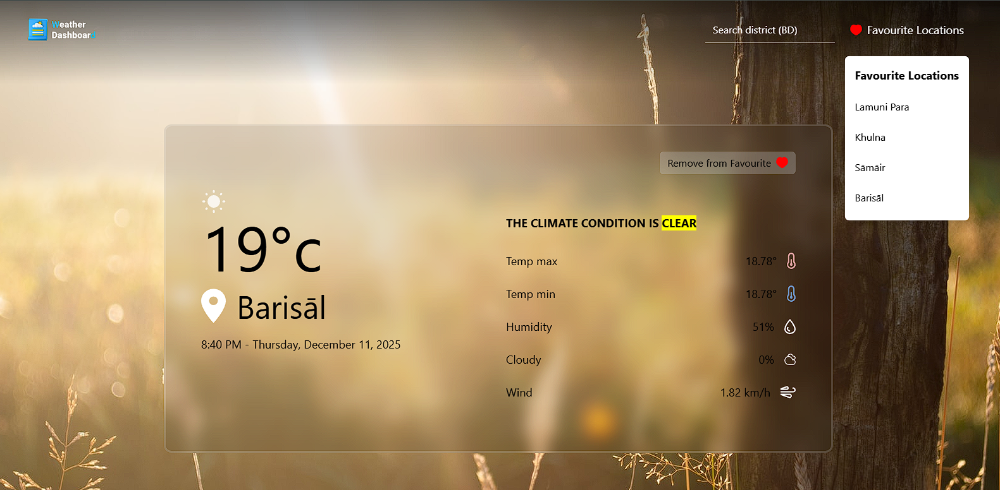
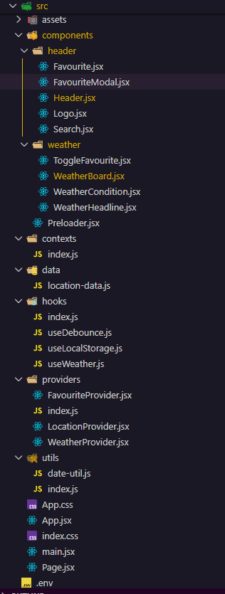

# 🌤️ Weather Dashboard App

A modern, responsive, and feature-rich **Weather Dashboard App** built with **React**, following clean architecture, Composition Pattern, Context API, Custom Hooks, and optimized Debounce search.  
This application delivers real-time weather data, favourite location management, and a smooth user experience with clean UI design.

---

## 📸 Application Preview

### 🌄 UI Screenshot



---

## 🧩 System Architecture Diagram



---

## 🚀 Features

### 🌦️ Real-Time Weather Data

- Current temperature
- Climate condition
- Humidity, wind, cloud status
- Min/Max temperature

### 🔍 Search with Debounce

- Fast & optimized search
- Prevents unnecessary API calls

### ❤️ Favourite Locations

- Add any location to favourite
- View all favourites in a modal
- Remove instantly
- Stored via LocalStorage using custom hook

### 🧠 Three Dedicated Contexts

- **SearchContext** — manages search input & interactions
- **LocationContext** — updates coordinates & triggers API
- **FavouriteContext** — stores favourite locations persistently

### 🔧 Custom Hooks

- `useDebounce` — search optimization
- `useWeather` — weather fetching logic
- `useLocalStorage` — persistent storage

### 🧱 Composition Pattern

- Clean, reusable and scalable component structure

---

## 🛠️ Tech Stack

| Category         | Tools                  |
| ---------------- | ---------------------- |
| Framework        | React                  |
| State Management | Context API            |
| Architecture     | Composition Pattern    |
| Optimizations    | Debounce, Custom Hooks |
| Data Source      | Weather API            |
| Storage          | LocalStorage           |

---

## 📂 Folder Structure

```
src/
├── assets/
├── components/
│   ├── header/
│   │   ├── Favourite.jsx
│   │   ├── FavouriteModal.jsx
│   │   ├── Header.jsx
│   │   ├── Logo.jsx
│   │   └── Search.jsx
│   └── weather/
│       ├── ToggleFavourite.jsx
│       ├── WeatherBoard.jsx
│       ├── WeatherCondition.jsx
│       ├── WeatherHeadline.jsx
│       └── Preloader.jsx
├── contexts/
│   └── index.js
├── data/
│   └── location-data.js
├── hooks/
│   ├── useDebounce.js
│   ├── useLocalStorage.js
│   ├── useWeather.js
│   └── index.js
├── providers/
│   ├── FavouriteProvider.jsx
│   ├── LocationProvider.jsx
│   ├── WeatherProvider.jsx
│   └── index.js
├── utils/
│   ├── date-util.js
│   └── index.js
├── App.jsx
├── Page.jsx
├── main.jsx
├── App.css
├── index.css
└── .env
```

---

## 🔧 Environment Variables

Create a `.env` file at the root:

```
VITE_WEATHER_API_KEY=your_api_key_here
```

---

## 🧪 How It Works (Internal Logic)

### ✔️ Weather Flow

1. User searches or selects a location
2. `LocationContext` stores latitude & longitude
3. `useWeather` fetches data
4. Rendered in `WeatherBoard`

### ✔️ Debounce Search

```
User typing → Debounce delay → API call → Results → UI update
```

### ✔️ Favourites

- Stored in LocalStorage via `useLocalStorage`
- Accessible from Favourite modal

---

## ▶️ Run Locally

### Clone the repository

```sh
git clone https://github.com/jahidIqbalBiswas/weather-dashboard-app.git
```

### Navigate to project folder

```sh
cd weather-dashboard-app
```

### Install dependencies

```sh
npm install
```

### Start the development server

```sh
npm run dev
```

---

## 📦 Build for Production

```sh
npm run build
```

---

## 🤝 Contributing

Contributions are welcome!  
Please open an issue before starting major changes.

---

## 📜 License

MIT License © 2025 — Weather Dashboard App

---

## 👨‍💻 Author

**Jahid Iqbal Biswas**  
Frontend Developer • React & JavaScript Enthusiast
